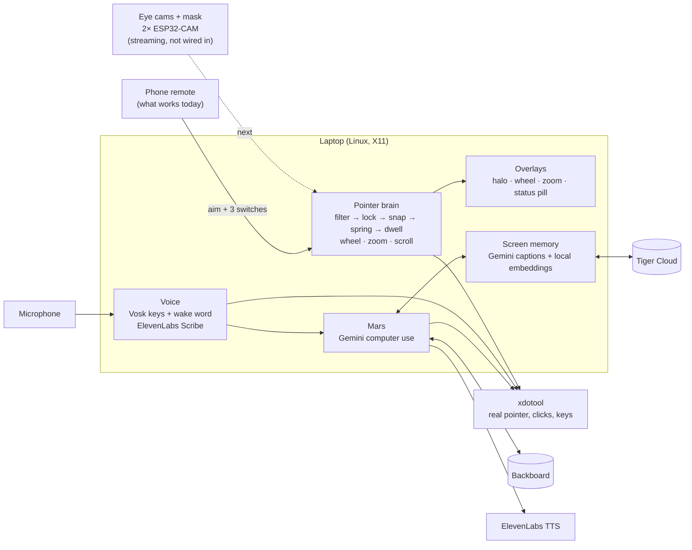

# MARS

*Multimodal Aided Retrieval System*

**Hands-free desktop control, designed for eye gaze. For now you point with your phone, held like a TV remote. Its buttons or your voice do the rest.**

> **Where it stands.** What works today is the **phone-remote version**. Aim the phone at the screen and the real pointer follows; the phone's three buttons are the switches. The eye-tracking hardware is partway there. An ESP32 eye cam streams live video to the laptop, but it doesn't drive the pointer yet. We've printed the mask that holds the cameras, but it still needs refining. Wiring the cams into the pointer is our next step: see [What's next](#whats-next).

MARS is for people who can talk but can't use their hands well: spinal cord injury, muscular dystrophy, ALS, MS, stroke, severe arthritis. The goal is an open eye-tracking setup you build yourself. Two ESP32 cameras on a 3D-printed mask watch the eyes, and a pointer built around how gaze really behaves moves the real mouse. Voice handles the rest: dictation, game keys, and **Mars**, an assistant that operates the computer for you.

Built at **CodeRED Orion 2026** (University of Houston, Oct 10–11), where it won **[MLH] Best Use of Backboard**. [Devpost](https://devpost.com/software/orion-qm3yaw) · [Demo video](https://youtu.be/y3NREzp5fB8)

## Why

- **Voice control types well but points badly.** Windows Voice Access, Voice Control and Dragon are free or cheap and great for dictation. Pointing by voice means number grids: "show grid, seven, three, click".
- **Eye trackers fix pointing, but they're expensive and closed.** A Tobii Dynavox PCEye 5 is about [$1,249](https://montech.ruralinstitute.umt.edu/mtdb/item_view.asp?ID=8366).
- **Every body is different.** An open build can be refit to one person. A closed device can't.

We're not trying to out-build a medical-grade tracker. We're making something cheap and open that anyone can build, adapt to someone they care about, and improve.

## Using it today: the phone remote

The pointer takes raw aim and doesn't care where it comes from. Until the eye cams are wired in, a phone stands in for them through [Gymote](https://github.com/dulnan/gymote): hold it like a TV remote, and its gyroscope gives a point on the screen.

- **Aim** the phone, and the real desktop pointer follows.
- **Left, Right and Menu**, the phone's three big buttons, are the three switches a gaze user would press.
- **Center** makes where you're aiming the middle of the screen again when the aim drifts.

The phone is only a remote: the laptop does all the work. Like gaze, phone aim is jittery and drifts, which made it a good stand-in for tuning the pointer. Once the eye cams are wired in, they'll feed the pointer at the same point and the phone goes away.

## What it does

### A pointer made for eyes

Raw gaze makes a bad mouse: it jitters, drifts and lands a little off. The pointer layer ([`desktop/server/pointer/`](desktop/server/pointer/)) is designed around that, and tuned with the phone:

- **Smoothing without lag.** A One Euro filter smooths hard when you're still and barely at all when you move.
- **Fixation lock.** Hold still for 100 ms and the pointer locks, so tremor doesn't move it at all.
- **Creep.** A small, slow correction toward a nearby button still gets through the lock.
- **No overshoot.** A critically damped spring moves the real pointer: a jump is 90% done in about 70–80 ms.
- **A halo, not an arrow.** The OS arrow is hidden and a soft halo shows where you're pointing, so the cursor doesn't pull your eye after it.
- **Nothing is clicked just because you looked at it.** Clicks come from a switch. Dwell-to-click is there, but off by default.

### Everything from three switches

Many switch users have two or three switches. MARS needs three: **Left**, **Right** and **Menu**. For now they're the phone's three buttons. Menu opens an on-screen wheel around the pointer:

- **Zoom-click:** a frozen 3× snapshot around the pointer, for hitting small targets. Nothing moves under your eye.
- **Click types:** double, triple, middle, and drag & drop.
- **Scroll**, **Pause**, **Dictate**, **Mars**, and **Settings** (dwell, snap-to-buttons, AI targets, voice).
- **Snap to buttons** (optional): uses the accessibility tree, plus Gemini to find buttons in apps that hide theirs.

### Voice

- **Dictation.** Speak, and ElevenLabs Scribe types it into whatever has focus, punctuated and capitalised.
- **Voice keys for games.** Say "left left up", "jump" or "hold up". Offline Vosk listens only for these words, so a key fires about 0.2 s after you say it.
- **"Hey Mars".** An offline wake word, with sound-alike decoys ("hey Mark", "hey mom", "Mars bar") so near-misses don't wake it.

### Mars: an assistant that uses the computer for you

- **Ask in plain words:** "reply to Sam that I'm running late", "open the recipe I had up this morning". Gemini computer use (`gemini-3.8-flash`) sees the screen and drives the real desktop.
- **It talks back** with ElevenLabs text-to-speech, and offers the obvious next step ("Your essay is due Friday. Want me to open it?"). You answer yes or no.
- **You stay in control.** Nothing is sent until you press OK. Gemini's own safety checks come to you as Yes / No, and Stop works at any moment.

### Memory

- **Screen memory, on Tiger Data.** Mars remembers what was on the screen, so you can ask "what was that error in my terminal earlier?" or "how long was I on YouTube today?".
  - Changed frames are captioned by Gemini and embedded locally (Ollama).
  - They're stored in Tiger Cloud, and search combines meaning with exact words.
  - Screenshots never leave the laptop.
- **It remembers you, on Backboard.** Say "remember that my sister is Ana" once, and next week "message my sister" just works.

## In progress: the mask and the eye cams


This is the hardware that will replace the phone. It isn't wired in end to end yet.

- **The mask** ([`mount/`](mount/)): a 3D-printed, glasses-style frame that rests on the nose and ears and holds the cameras.
  - We've printed it (about an hour in PLA), but it isn't refined yet. It has to fit snugly: if it slips, the cameras move relative to the eyes and the calibration goes off.
  - The Blender source is included, so it can be refit to one person's face.
- **The ESP32 eye cams** ([`eyecam/`](eyecam/)): they stream live video to the laptop, but don't drive the pointer yet.
  - Our first firmware sent each frame as base64 JSON over HTTPS. It ran out of memory on the board.
  - We rewrote it to stream MJPEG over plain HTTP. Live video from the cam now reaches the laptop.
  - The campus guest Wi-Fi stops devices from reaching each other, so the cams need a phone hotspot.
- **The pupil reader** ([`eyecam/host/`](eyecam/host/)): runs on the laptop, keeps only the newest frame so latency stays flat, and finds the pupil as the darkest round blob. So far it has only been tested against a simulated ESP32 stream.

<br clear="right">

## Status

| Part | State |
|---|---|
| **Phone remote**: aim, three buttons, Center | **Working.** This is the version to try |
| Pointer, wheel, zoom-click, click types, scroll, dwell | Working. 34 automated pointer tests pass |
| Dictation, voice keys, "Hey Mars" | Working |
| Mars (Gemini computer use) with spoken replies | Working |
| Screen memory (Tiger Cloud), person memory (Backboard) | Working |
| Mask | Printed. Fit not refined yet |
| ESP32 eye cams | **Streaming.** Live video reaches the laptop; not wired into the pointer yet |
| Laptop pupil reader | Tested only against a simulated ESP32 stream: 24 fps, pupil found in 138 of 138 frames |
| Eye cams → pointer | Not started. Needs the pupil reader on real eye video, IR LEDs, and calibration |

## How it works



The phone links to the laptop over WebRTC. The server does all mic capture and every action. Details are in [`desktop/README.md`](desktop/README.md#how-it-works).

## Sponsor tech

- **Gemini API.**
  - Mars runs on Gemini computer use: the Interactions API's `computer_use` tool with `environment: "desktop"`, plus our own function tools.
  - Gemini also captions screen-memory frames, and finds clickable boxes (`box_2d`) in apps that hide their accessibility tree.
  - Code: [`gemini.ts`](desktop/server/gemini.ts), [`agent.ts`](desktop/server/agent.ts), [`vision-targets.ts`](desktop/server/vision-targets.ts), [`memory/caption.ts`](desktop/server/memory/caption.ts).
- **ElevenLabs.**
  - Scribe turns speech into text for dictation and Mars commands.
  - Text-to-speech gives Mars its voice.
  - Code: [`speech.ts`](desktop/server/speech.ts), [`dictation.ts`](desktop/server/dictation.ts), [`voice.ts`](desktop/server/voice.ts).
- **Tiger Data.** Screen memory lives in Tiger Cloud:
  - `frames` and `events` are hypertables.
  - Search is one SQL query: pgvector (HNSW) and BM25 (`pg_textsearch`) rankings, fused by reciprocal rank fusion.
  - The continuous aggregates `activity_15m` and `events_15m` answer screen-time questions. A therapist could follow the same numbers over weeks.
  - Code: [`memory/db.ts`](desktop/server/memory/db.ts).
- **Backboard.** Long-term memory of the person: people, preferences and past requests. It's recalled into each Mars request, and Mars has tools to save and look things up. Code: [`backboard.ts`](desktop/server/backboard.ts).

Also built with: Vosk, Ollama (`embeddinggemma`), AT-SPI, GTK + cairo, Gymote, Vite + TypeScript, the ESP32 Arduino core, and OpenCV.

## Repo layout

| Folder | What's in it |
|---|---|
| [`desktop/`](desktop/) | **The part that works today.** The laptop app driven by the phone remote: pointer, wheel, overlays, dictation, voice keys, Mars, memory. Full guide in [`desktop/README.md`](desktop/README.md) |
| [`eyecam/`](eyecam/) | **Work in progress.** Streams video; not wired into the pointer yet. ESP32-CAM firmware, flash script and laptop pupil reader. Wiring and flashing in [`eyecam/README.md`](eyecam/README.md) |
| [`mount/`](mount/) | **Work in progress.** The 3D-printed mask, printed but not refined: STL files, the Blender source, and print settings in [`mount/README.md`](mount/README.md) |

## Run it

You need a Linux laptop on an **X11** session (on GNOME, pick "Ubuntu on Xorg" at login), a phone, [ngrok](https://ngrok.com/), and API keys.

```bash
sudo apt install xdotool x11-utils ffmpeg alsa-utils python3-gi python3-gi-cairo gir1.2-gtk-3.0 gir1.2-atspi-2.0
cd desktop
npm install
npm run setup:keys          # once: offline Vosk model for voice keys and "Hey Mars"
cp .env.example .env        # GEMINI_API_KEY, ELEVENLABS_API_KEY; optional BACKBOARD_API_KEY, TIGER_DATABASE_URL
npm run dev                 # server on 127.0.0.1:5176
npm run app                 # second terminal: the control page in its own Chrome window
ngrok http 127.0.0.1:5176   # third terminal: phones need https for motion data
```

Scan the QR code on the control page with the phone and tap **Tap to start**. Aim at the screen and press **Menu** to open the wheel. Screen memory also needs Ollama (`ollama pull embeddinggemma`).

**Testing without a phone or mic:**

```bash
cd desktop
npm run test:pointer        # 34 pointer cases, with fake time
npm run test:keys           # voice word → key logic
GM_DRY_RUN=1 npm run dev    # log pointer actions instead of moving the mouse
```

**Working on the eye cams?** They stream, but aren't wired into the pointer yet. Setup, wiring and flashing are in [`eyecam/README.md`](eyecam/README.md).

## Safety and privacy

- **Mars asks first.** It does nothing with a recording until you press OK. With `SAFE_MODE=1` it asks before risky actions. While it works, Right on the phone stops it.
- **Screen memory is off until you turn it on.**
  - Screenshots stay on the laptop.
  - Windows that look private are never saved: password managers, private browsing, banking, chat apps, and editors showing `.env` files or keys.
- **Nobody else can drive it.** The server listens only on loopback, and the phone needs the pairing code from the QR.
- **IR needs a check first.** The eye-cam firmware forces the board's flash LED off, since it sits next to an eye. IR illumination needs an eye-safety check before anyone wears it; follow [EyeTrackVR](https://github.com/eyetrackvr/eyetrackvr)'s IR notes.

## What's next

The hardware, in order:

1. **Wire the eye cams in.** They already stream to the laptop over a phone hotspot; next, run the pupil reader on their live video, mounted on the mask.
2. **Refine the mask** so it fits snugly and holds the cameras steady in front of the eyes, without slipping.
3. **Add IR lighting**, after an eye-safety check, so the pupil is easy to find.
4. **Calibrate** pupil position to a point on the screen.
5. **Swap the phone for the eyes.** Gaze feeds the pointer where the phone's aim does now. The pointer, wheel, voice and Mars don't change.

After that:

- **Head pose.** Use the webcam to fine-tune the aim after a coarse gaze jump.
- **Real users.** Test with occupational therapists and the people this is for. We haven't yet.
- **Weaker voices.** Speech can be affected too: ventilator users, quieter voices with Parkinson's, later-stage ALS. The switch-and-wheel path works without speaking, but it's slower.

## Team

- Junda Yin ([@Deiahri](https://github.com/Deiahri))
- Jonah Phillips ([@jonahp-coding](https://github.com/jonahp-coding))
- Gabriel Eisenberg ([@eisenbergabe](https://github.com/eisenbergabe))
- Murphy Amos ([@MurphyAmos](https://github.com/MurphyAmos))

## License

[MIT](LICENSE). Build it, change it, fit it to someone, and share what you improve.
