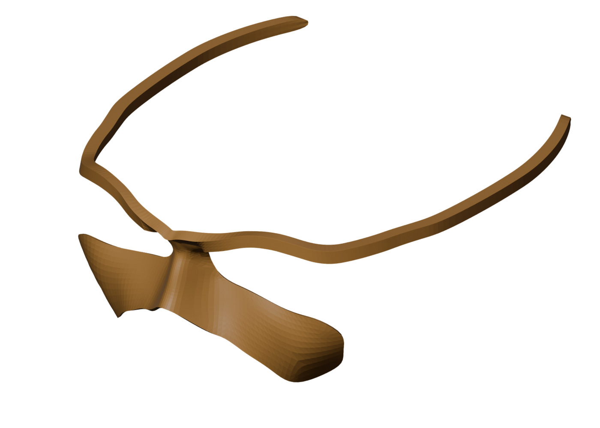

# MARS: the mask

A 3D-printed, glasses-style frame (the mask) that rests on the nose and ears and carries the [eye cams](../eyecam/) for [MARS](../README.md).

> **Printed, not refined yet.** We've printed it, but the fit still needs work, and the [eye cams](../eyecam/) it holds aren't wired into the pointer yet. Until they are, MARS runs on the [phone remote](../README.md#using-it-today-the-phone-remote).

| File | What it is | Size (mm) | Print time | Filament |
|---|---|---|---|---|
| [`face-mount-big.stl`](face-mount-big.stl) | The newest and largest version | 119 × 125 × 50 | ~60 min | 4.3 m |
| [`face-mount.stl`](face-mount.stl) | An earlier, smaller version | 95 × 74 × 39 | ~36 min | 2.1 m |
| [`nose-piece.stl`](nose-piece.stl) | The nose piece on its own | 25 × 13 × 28 | ~26 min | 0.7 m |
| [`face-mount.blend`](face-mount.blend) | The Blender source | | | |

## Printing

These are the settings we sliced with in Cura 5.10:

- PLA, with the nozzle at 200 °C and the bed at 60 °C.
- 0.2 mm layers.
- **Supports on.**

Times are Cura's estimates on our printer. Your printer will differ, so slice the STL yourself. We don't ship our gcode because it's specific to our printer.

## Fitting it

Every face is different, and an open design means you can change the frame to fit one person. Open `face-mount.blend`, adjust it, and export a new STL.

If the frame slips on the face, the eye cams move relative to the eyes and the calibration goes off, so a snug fit matters.

## Next

- **A snug fit** that doesn't slip on the face.
- **Holding the cameras steady** in front of the eyes, once the eye cams work.
